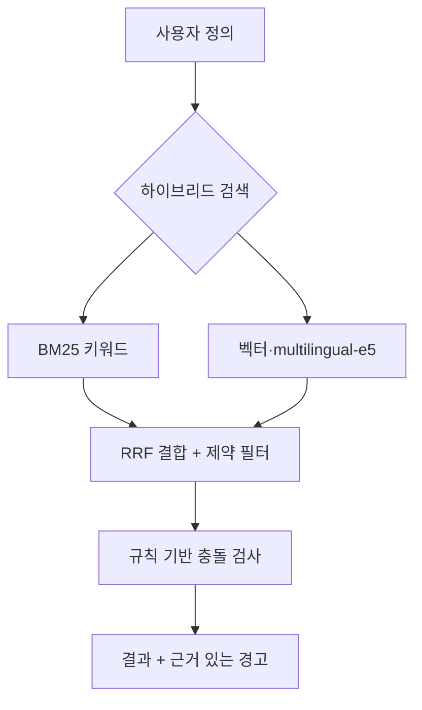

# 🌸 K-beauty-advisor-Goun(고은)
피부 타입과 고민을 말하면, 성분 근거와 함께 K-뷰티 루틴을 추천해주는 RAG 기반 AI 에이전트

[](https://www.python.org/)
[](https://fastapi.tiangolo.com/)
[](https://www.langchain.com/langgraph)
[](https://www.trychroma.com/)

---

## 📌 Why — 왜 만들었나
> "K-뷰티 제품은 수천 개인데, 내 피부에 맞는 걸 근거 있게 골라주는 곳은 없다."

- 고객들은 레티놀·AHA·비타민C 같은 활성 성분을 섞어 사용하면서도, 어떤 조합이 자극을 주거나 효과를 떨어뜨리는지 잘 모릅니다.
- 일반 LLM 챗봇은 성분 정보를 그럴듯하게 지어낼(할루시네이션) 수 있어서, 안전과 관련된 조언에는 부적합합니다.
- 브랜드는 수많은 리뷰와 상담 데이터를 가지고 있지만, 이를 상품 의사결정으로 연결하지 못하는 경우가 많습니다.
- 각자 다른 피부 타입을 가지고 있는 고객들에게는 개개인에 맞춤형으로 정보를 제공해줘야 합니다.

Goun(고은)은 안전 판단은 규칙과 코드로 결정적으로, LLM은 이해와 설명에만 사용하도록 역할을 나눴습니다.
> Growth PM이자, Ai engineer로서 일하며 RAG 평가 파이프라인을 만들었던 경험을 관심 산업인 **뷰티 도메인**에 적용해 보고자 했습니다.

---

## ✨ 주요 기능

- [ ] 성분 파싱·정규화 (INCI 표준명, Vitamin C → ascorbic acid 등 동의어 처리)
- [ ] 심각도·근거 수준이 포함된 규칙 기반 성분 충돌 검사
- [ ] 하이브리드 검색 (BM25 + 다국어 임베딩, RRF) + 예산·기피 성분 하드 필터
- [ ] 사람 확인(HITL) 단계가 포함된 LangGraph 상담 흐름
- [ ] 자기 수정형 컴플라이언스 가드레일·MCP 서버·한/영/스페인어 응답
- [ ] 상품기획팀용 리뷰 인사이트 리포트


| 기능 | 설명 |
|---|---|
| 🧴 **피부 진단 대화** | 피부 타입·고민·민감 성분을 3~5턴 대화로 파악 |
| 🔍 **근거 기반 추천** | 모든 추천에 출처(제품 DB / 성분 자료) 인용 |
| ⚠️ **성분 충돌 체크** | 레티놀 + AHA 동시 사용 등 주의 조합 경고 |
| 🌎 **다국어 응답** | 한국어 · English · Español |
| 🗓️ **AM/PM 루틴 생성** | 단계별 사용 순서와 이유 제시 |

---

## 🧠 아키텍처 및 로직

```md


---